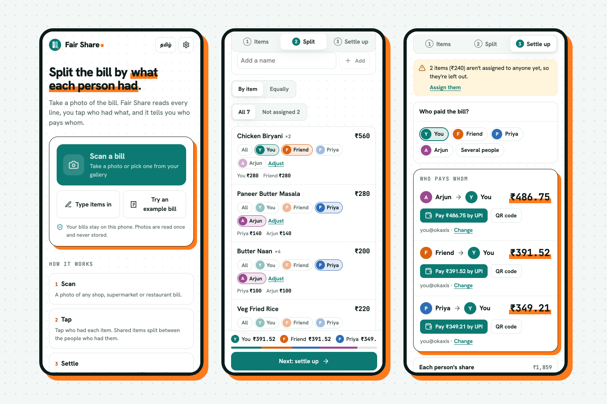

<div align="center">


# Fair Share

**Split a bill by what each person had.**
Take a photo of the bill, tap who had what, and see who pays whom.

[**Open the app →**](https://fair-share-dgs.vercel.app) · Free · No sign-up · Works on any phone · English and தமிழ்



</div>

## Why

Splitting a bill equally is easy. Splitting it fairly is not: one person had the biryani, two shared the naan, someone only had a lime soda, and the GST and service charge sit on top of everything. Fair Share reads every line of the bill for you and does the maths down to the paisa.

## What it does

- **Scan any bill.** Shop, supermarket or restaurant. The AI reads every line, cleans up cryptic names (`MAGGI MASALA N-560g` → *Maggi Masala Noodles 560g*), and checks that the lines add up to the printed total.
- **Tap who had what.** Tap a name, then tap that person's items. Shared items split between the people who had them, by quantity if needed (2 of the 3 doormats).
- **Or split equally.** One switch splits the whole bill equally.
- **Tax, service, tip and discounts, shared fairly.** They follow what each person had, or split equally if you prefer. Type `5%` and it works out the amount.
- **Several payers.** If two people paid parts of the bill, it still works out who owes whom, in the fewest payments.
- **Pay by UPI.** Add the UPI ID of whoever gets paid to get a pay button and a QR code for GPay, PhonePe, Paytm or any bank app.
- **Send it.** Share the breakdown on WhatsApp, as text, or as a link that opens the same split for your friends.
- **Private.** Bills stay on your phone. Photos are read once and never stored. There are no accounts, trackers or ads.
- **Install it.** Add it to your home screen and it works like an app, offline too (scanning needs a connection).
- **Tamil.** The whole app is available in தமிழ்.

## How the scanning works

1. The photo is resized on the phone and sent to a small serverless function (`api/scan.ts`).
2. The function asks Google Gemini to return the bill as structured JSON: items, quantities, line totals, extras and the printed total. Nothing is logged or saved.
3. If the free AI quota is used up, the site isn't configured, or you're offline, the phone reads the bill itself with [Tesseract.js](https://github.com/naptha/tesseract.js). That is less accurate, so the app asks you to check the lines against the photo.
4. Either way, the app compares the lines with the printed total and offers to fix any difference.

People who hit the daily limit can paste their own free Gemini key in Settings. It stays on their phone and goes only to Google.

## Run it yourself

```bash
git clone https://github.com/Abbishekk-DGS/fair-share.git
cd fair-share
npm install
npm run dev        # http://localhost:3191
npm test
```

`npm run dev` serves the app without the scan function, so scans use the on-phone reader. To test AI scanning locally, run `npx vercel dev` with a key in `.env.local`.

### Deploy your own

1. Get a free Gemini API key at [aistudio.google.com/apikey](https://aistudio.google.com/apikey).
2. Import this repo on [Vercel](https://vercel.com/new) (it's detected as a Vite app; `api/scan.ts` becomes a function).
3. Add the environment variable `GEMINI_API_KEY`. Optionally set `GEMINI_MODELS` (comma separated, tried in order; default `gemini-flash-latest,gemini-flash-lite-latest`).

| Variable | Required | What it does |
|---|---|---|
| `GEMINI_API_KEY` | For AI scanning | Server-side key used by `/api/scan`. Never sent to the browser. |
| `GEMINI_MODELS` | No | Models to try, in order, when one is over quota. |

## How the maths stays exact

All money is stored in paise (integers). Every split uses the largest-remainder method, so the parts always add back to the exact total: ₹10 split three ways is ₹3.34 + ₹3.33 + ₹3.33, never ₹9.99. Settling up matches the person who owes most with the person who is owed most, which keeps the number of payments small. See [`src/lib/split.ts`](src/lib/split.ts) and its tests.

## Project layout

```
api/scan.ts          serverless function: photo → Gemini → JSON (rate-limited, nothing stored)
src/lib/split.ts     the split and settle-up maths
src/lib/scan.ts      photo prep, AI call, on-device fallback
src/lib/ocrParse.ts  turns raw OCR text into bill lines
src/lib/gemini.ts    prompt, response schema and clean-up
src/lib/i18n.ts      English and Tamil text
src/components/      Home, Items, Split, Settle, Settings screens
tests/               maths, parsing and config tests (Vitest)
```

Built with React, TypeScript and Vite. No UI framework, no tracking.

## Contributing

Issues and pull requests are welcome, especially bills the scanner reads badly (remove personal details first), new languages, and new currencies. Please run `npm test` and `npm run build` before opening a PR.

## Licence

[MIT](LICENSE). Use it, change it, ship it.

---

Designed and built by **[Abbishekk DGS](https://abbishekkdgs.tech)** · [GitHub](https://github.com/Abbishekk-DGS)
